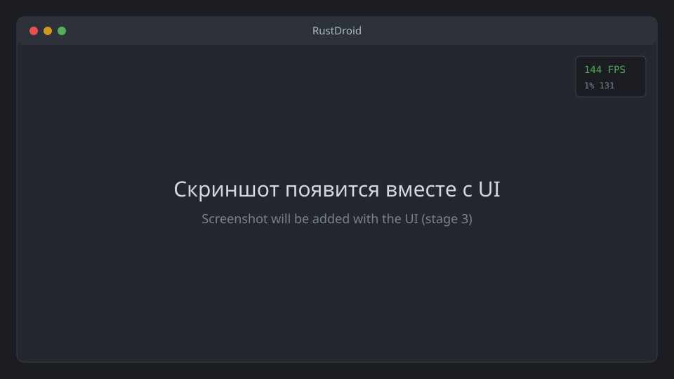

<div align="center">

# RustDroid

**An Android emulator for gaming on Windows 11, written from scratch in Rust.**
Own hypervisor on top of Windows Hypervisor Platform, virtio devices, zero-copy D3D12 output,
BlueStacks-class keymapping. Performance is priority #1.

[](https://github.com/Zaxar1231/GSPC/actions/workflows/ci.yml)
[](https://github.com/Zaxar1231/GSPC/releases)
[](#license)
[](https://github.com/Zaxar1231/GSPC/releases)

[Русский](README.md) · [Architecture (RU)](docs/architecture.md) · [Roadmap (RU)](docs/roadmap.md)

</div>

> [!WARNING]
> Early stage (stage 1: minimal VMM). A Linux kernel with initramfs boots to a serial shell — see
> [docs/stage-1.md](docs/stage-1.md) (RU). Android and the display window arrive in stages 2–3.
> Primary documentation is in Russian.



## Goals

- **Own VMM in Rust on WHPX.** No QEMU, VirtualBox or third-party emulator underneath.
  Coexists with Hyper-V, WSL2 and Memory Integrity.
- **Smoothness first.** Stable 60 FPS in heavy games, 90/120/144+ where the game allows it;
  1% low ≥ 85% of average; no shader-compilation stutter.
- **Zero-copy graphics.** The guest renders through gfxstream + ANGLE-on-Vulkan on your GPU and the
  frame reaches a D3D12 flip-model swapchain without CPU copies. VSync / no VSync / FPS cap / VRR.
- **Low input latency.** Raw Input on a dedicated thread, forwarded to the guest immediately.
  Target: < 30 ms at ≥ 90 FPS or VRR, < 45 ms at 60 Hz with VSync.
- **Keymapping**, visual editor, per-game profiles, **BlueStacks layout import**.
- **Multi-instance and snapshots**, start from a snapshot in < 5 s.
- **Material Design 3 UI**, light and dark themes.
- **A real product:** installer, auto-update (stable/beta), rollback, crash reports.

## System requirements

| | Minimum | Recommended |
|---|---|---|
| OS | Windows 11 x64 (21H2+) | Windows 11 24H2+ |
| CPU | 4 cores, VT-x or AMD-V (SVM) | 8+ cores |
| RAM | 8 GB | 16 GB+ |
| GPU | Vulkan 1.3 and D3D12 | Discrete NVIDIA/AMD or Intel Arc, recent driver |
| Windows feature | Windows Hypervisor Platform | — |

Windows 10 is not supported.

## Building from source

Requires Windows 11 x64, [rustup](https://rustup.rs), Visual Studio 2022 Build Tools (C++ workload), Git.

```powershell
git clone https://github.com/Zaxar1231/GSPC.git RustDroid
cd RustDroid
cargo build --release      # Rust version is pinned in rust-toolchain.toml
cargo xtask ci             # fmt + clippy -D warnings + tests, same as CI
```

## FAQ

- **Enable virtualization:** Task Manager → Performance → CPU → "Virtualization". If disabled,
  enable Intel VT-x or AMD SVM in UEFI setup.
- **Enable WHPX:** `Enable-WindowsOptionalFeature -Online -FeatureName HypervisorPlatform -All` (admin), then reboot.
- **Other emulators:** emulators that require raw VT-x (older LDPlayer/Nox/MEmu, BlueStacks without
  Hyper-V support) stop working once Hyper-V is enabled.
- **Google Play:** not bundled (requires a Google license). microG is an optional per-instance setting.
- **ARM-only games:** supported through a user-supplied translator (libndk_translation / libhoudini),
  which we cannot redistribute. A native ARM64→x86_64 translator is a long-term goal.
- **Anti-cheat / Play Integrity:** we do not and will not bypass them.

## License

Licensed under either of Apache License 2.0 ([LICENSE-APACHE](LICENSE-APACHE)) or MIT
([LICENSE-MIT](LICENSE-MIT)) at your option. Unless you explicitly state otherwise, any
contribution intentionally submitted for inclusion shall be dual licensed as above, without
additional terms or conditions.

Guest components carry their own licenses (AOSP: mostly Apache-2.0; Linux kernel: GPL-2.0;
gfxstream: Apache-2.0). ARM translators are proprietary and are not distributed with RustDroid.
Android is a trademark of Google LLC. RustDroid is not affiliated with Google, BlueStacks or Microsoft.
