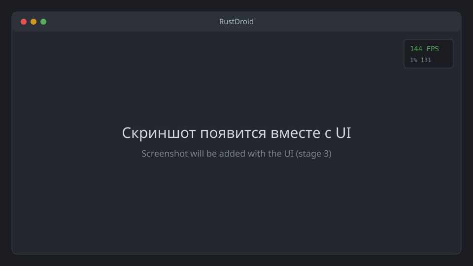

<div align="center">

# RustDroid

**Android-эмулятор для игр на Windows 11, написанный с нуля на Rust.**
Свой гипервизор поверх Windows Hypervisor Platform, virtio-устройства, D3D12-вывод без копий,
keymapping уровня BlueStacks. Производительность — приоритет №1.

[](https://github.com/Zaxar1231/GSPC/actions/workflows/ci.yml)
[](https://github.com/Zaxar1231/GSPC/releases)
[](#лицензия)
[](https://github.com/Zaxar1231/GSPC/releases)

[English](README.en.md) · [Архитектура](docs/architecture.md) · [Roadmap](docs/roadmap.md) · [Производительность](docs/performance.md)

</div>

> [!WARNING]
> Проект на ранней стадии (этап 1: минимальный VMM). Уже можно загрузить ядро Linux с
> initramfs и получить шелл в консоли — см. [docs/stage-1.md](docs/stage-1.md). Android и окно
> с экраном появятся на этапах 2–3.



## Ключевые возможности (цели)

- **Свой VMM на Rust поверх WHPX.** Никакого QEMU, VirtualBox или чужих эмуляторов в основе.
  Работает рядом с Hyper-V, WSL2 и Memory Integrity.
- **Плавность прежде всего.** Цель: стабильные 60 FPS в тяжёлых играх, 90/120/144+ там, где
  игра позволяет; 1% low не ниже 85% от среднего; без статтеров от шейдеров.
- **Zero-copy графика.** Гость рендерит через gfxstream + ANGLE-on-Vulkan на вашей видеокарте,
  кадр попадает в D3D12-swapchain без копирования через CPU. VSync, без VSync, лимит FPS, G-Sync/FreeSync.
- **Низкая задержка ввода.** Raw Input в отдельном потоке, событие сразу уходит в гостя.
  Цель: < 30 мс при ≥ 90 FPS или VRR, < 45 мс при 60 Гц с VSync.
- **Keymapping.** Tap, стик, прицел, стрельба, свайпы, повтор, удержание, зум, макросы,
  MOBA-скиллы, геймпад. Визуальный редактор, автопереключение профилей по игре.
- **Импорт раскладок BlueStacks.**
- **Мультиинстанс и снапшоты.** Старт из снапшота меньше чем за 5 секунд.
- **Интерфейс в стиле Material Design 3**: светлая и тёмная темы, палитра из акцентного цвета Windows.
- **Нормальный продукт.** Установщик, автообновление (stable/beta), откат, отчёты о сбоях.

## Системные требования

| | Минимум | Рекомендуется |
|---|---|---|
| ОС | Windows 11 x64 (21H2+) | Windows 11 24H2+ |
| CPU | 4 ядра, VT-x или AMD-V (SVM) | 8+ ядер (на гибридных Intel учитываются P-ядра) |
| ОЗУ | 8 ГБ | 16 ГБ+ |
| GPU | Vulkan 1.3 и D3D12 | Дискретная NVIDIA/AMD или Intel Arc со свежим драйвером |
| Диск | 10 ГБ свободно, SSD | NVMe SSD |
| Компоненты Windows | Windows Hypervisor Platform | — |

Windows 10 не поддерживается.

## Установка

Будет на этапе 7: установщик проверит совместимость, при необходимости включит
Windows Hypervisor Platform (UAC запросится только на этот шаг) и попросит перезагрузку.
До этого времени собирайте из исходников.

## Быстрый старт

Сейчас (этап 1) — загрузка ядра Linux в консоли, подробно в [docs/stage-1.md](docs/stage-1.md):

```powershell
cargo build --release
.\target\release\rustdroid.exe check
cargo xtask busybox-initramfs
cargo xtask guest-fetch --kernel-build <НОМЕР_СБОРКИ>
.\target\release\rustdroid.exe boot --kernel guest\cache\bzImage-<НОМЕР_СБОРКИ> --initrd guest\cache\initramfs-busybox.cpio
```

Выход из консоли гостя: `Ctrl+A`, затем `X`.

## Сборка из исходников

Нужны Windows 11 x64, [rustup](https://rustup.rs), Visual Studio Build Tools 2022
(рабочая нагрузка «Разработка классических приложений на C++») и Git.

```powershell
git clone https://github.com/Zaxar1231/GSPC.git RustDroid
cd RustDroid
cargo build --release          # версия Rust зафиксирована в rust-toolchain.toml
cargo xtask ci                 # fmt + clippy -D warnings + тесты, как в CI
```

Бинарник: `target\release\rustdroid.exe`. Подробнее: [CONTRIBUTING.md](CONTRIBUTING.md).

## FAQ

<details>
<summary><b>Как включить виртуализацию в BIOS/UEFI?</b></summary>

Откройте «Диспетчер задач → Производительность → ЦП» и посмотрите на строку «Виртуализация».
Если там «Отключено», перезагрузитесь в UEFI (обычно клавиши Del, F2 или F10) и включите
**Intel Virtualization Technology (VT-x)** или **SVM Mode** на AMD. Пункт часто прячется
в разделах Advanced, CPU Configuration или Overclocking.
</details>

<details>
<summary><b>Как включить Windows Hypervisor Platform вручную?</b></summary>

«Включение или отключение компонентов Windows» → отметьте **Платформа низкоуровневой оболочки
Windows** → перезагрузка. Или в PowerShell от администратора:

```powershell
Enable-WindowsOptionalFeature -Online -FeatureName HypervisorPlatform -All
```
</details>

<details>
<summary><b>Конфликт с другими эмуляторами и VirtualBox/VMware</b></summary>

RustDroid работает поверх Hyper-V. После включения Windows Hypervisor Platform эмуляторы,
которым нужен «голый» VT-x (старые версии LDPlayer, Nox, MEmu, BlueStacks без поддержки
Hyper-V), перестанут запускаться или будут работать медленно. Современные версии VirtualBox
и VMware умеют работать поверх Hyper-V. BlueStacks 5 в Hyper-V-сборке работает одновременно с нами.
</details>

<details>
<summary><b>Влияет ли Hyper-V на FPS в обычных играх на ПК?</b></summary>

Когда Hyper-V включён, Windows сама работает как корневая партиция гипервизора. В большинстве
игр разница в пределах погрешности, в отдельных CPU-зависимых сценариях можно потерять
несколько процентов. Memory Integrity (HVCI) — отдельная настройка, нам она не нужна и не мешает.
</details>

<details>
<summary><b>Будет ли Google Play?</b></summary>

Нет: встраивать сервисы Google без лицензии Google нельзя. Будет опция microG в настройках
инстанса, установка APK/XAPK перетаскиванием и возможность поставить в инстанс что угодно самостоятельно.
</details>

<details>
<summary><b>Запустятся ли ARM-игры?</b></summary>

Да, если указать транслятор (libndk_translation или libhoudini). Распространять их мы не
имеем права, поэтому подключаются они пользователем. Там, где у игры есть x86_64-сборка,
она используется напрямую и работает быстрее. Свой ARM64→x86_64 транслятор — долгосрочная цель.
</details>

<details>
<summary><b>Игра пишет, что запущена на эмуляторе / не пускает в онлайн</b></summary>

Обход античитов и Play Integrity мы не делаем и не планируем. Такие игры попадают в список совместимости.
</details>

## Roadmap

| Этап | Содержание | Статус |
|---|---|---|
| 0 | Репозиторий, workspace, CI, документация | ✅ |
| 1 | Минимальный VMM на WHPX: ядро Linux + initramfs, serial-консоль | 🚧 |
| 2 | virtio-pci/MSI-X, virtio-blk, virtio-console: AOSP до шелла | ⏳ |
| 3 | virtio-gpu 2D, D3D12-композитор, virtio-input, оверлей производительности | ⏳ |
| 4 | 3D: gfxstream + ANGLE-on-Vulkan | ⏳ |
| 5 | virtio-net (NAT), virtio-vsock, гостевой агент | ⏳ |
| 6 | Keymapping, профили, редактор | ⏳ |
| 7 | Установщик, автообновление, релизный пайплайн | ⏳ |
| 8 | Импорт BlueStacks | ⏳ |
| 9 | Звук (virtio-snd → WASAPI) | ⏳ |
| 10 | Снапшоты, мультиинстанс, ярлыки, оптимизация задержки | ⏳ |
| 11 | Свой ARM64→x86_64 транслятор (долгосрочно) | ⏳ |

Подробности: [docs/roadmap.md](docs/roadmap.md).

## Участие

См. [CONTRIBUTING.md](CONTRIBUTING.md) и [CODE_OF_CONDUCT.md](CODE_OF_CONDUCT.md).
Об уязвимостях сообщайте приватно: [SECURITY.md](SECURITY.md).

## Лицензия

Код RustDroid распространяется на условиях любой из двух лицензий на ваш выбор:

- Apache License 2.0 ([LICENSE-APACHE](LICENSE-APACHE))
- MIT ([LICENSE-MIT](LICENSE-MIT))

Если вы явно не указали иное, любой вклад, намеренно отправленный вами для включения в проект,
лицензируется так же (MIT OR Apache-2.0), без дополнительных условий.

Гостевые компоненты имеют собственные лицензии: AOSP — в основном Apache-2.0, ядро Linux —
GPL-2.0 (исходники ядра и наши патчи публикуются), gfxstream — Apache-2.0. Трансляторы ARM
(libndk_translation, libhoudini) проприетарны и с RustDroid не распространяются.

Android — товарный знак Google LLC. RustDroid не связан с Google, BlueStacks или Microsoft.
