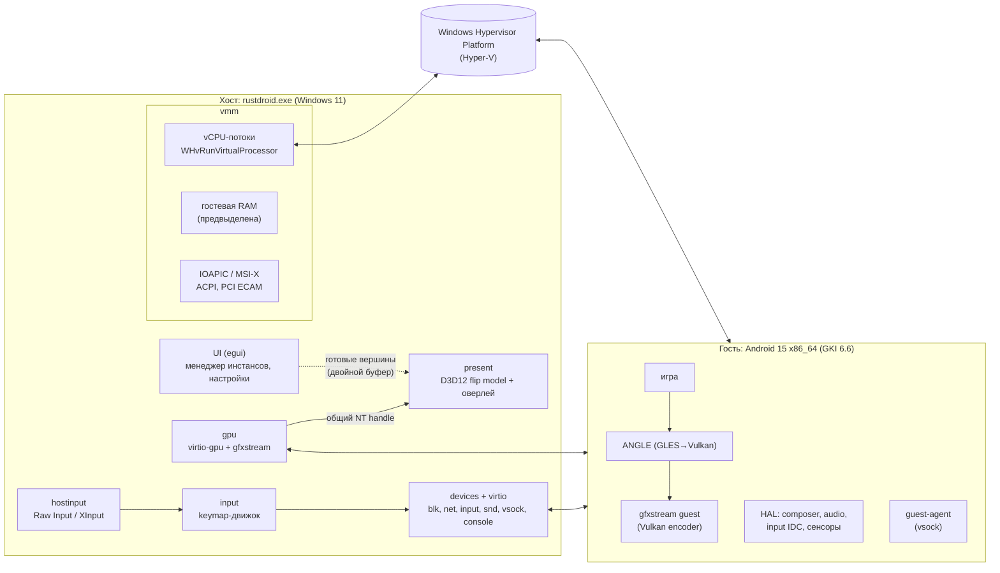
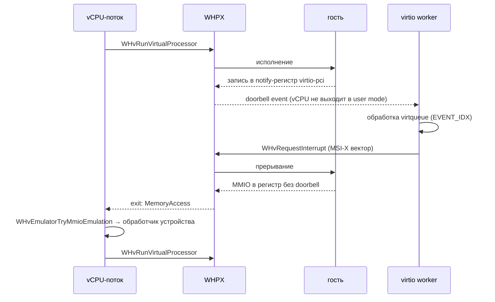
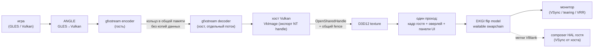
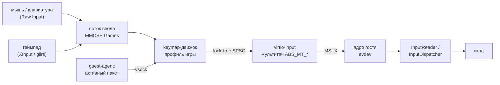

# Архитектура RustDroid

Документ описывает целевую архитектуру. Разделы помечены этапом, на котором они реализуются.
Принятые решения с обоснованием лежат в [docs/adr](adr/).

## Принципы

1. **Производительность — приоритет №1.** Каждое решение оценивается по влиянию на FPS,
   стабильность кадра (1% low) и задержку ввода.
2. **Только Windows 11 x64.** Никаких кроссплатформенных абстракций ради других ОС.
3. **Свой VMM.** QEMU, goldfish, VirtualBox и другие эмуляторы как бэкенд не используются.
   crosvm (его Windows-часть), Firecracker и cloud-hypervisor — референсы.
4. **Минимум выходов из гостя** и **ноль копий кадра через CPU**.

## Общая схема

## Потоки

| Поток | Приоритет | Ядра | Задача |
|---|---|---|---|
| vCPU × N | MMCSS «Games» | P-ядра (CPU Sets) | цикл `WHvRunVirtualProcessor`, обработка exits |
| virtio workers | высокий | любые | очереди устройств, просыпаются по doorbell-событиям |
| gfxstream decoders | высокий | P-ядра | исполнение GL/Vulkan-команд гостя на хост-GPU |
| present | MMCSS «Games» | P-ядро | композиция кадра и оверлея, Present, метки VBlank для гостя |
| raw input | MMCSS «Games» | любое | Raw Input → keymap → virtio-input, без ожидания кадра |
| audio | MMCSS «Pro Audio» | любое | WASAPI (`IAudioClient3`, малый период) |
| UI | обычный | любые | egui, настройки, меню; никогда не блокирует present |

Количество vCPU по умолчанию считается от числа P-ядер хоста, с запасом на декодер gfxstream и
present. Конкретное железо не зашивается: топология определяется через
`GetLogicalProcessorInformationEx` / `GetSystemCpuSetInformation` (EfficiencyClass).

## VMM на WHPX (этапы 1–2)

- **Партиция:** `ProcessorCount`, `LocalApicEmulationMode = X2Apic` (LAPIC и таймер в гипервизоре),
  `ExtendedVmExits` для CPUID/MSR, маскирование CPUID, invariant TSC.
- **Hyper-V enlightenments** для гостя: reference TSC page, synthetic timers, VP index. Минимальная
  ОС — Windows 11, поэтому без урезанных режимов.
- **Память:** RAM выделяется целиком при старте (`VirtualAlloc`, опционально `MEM_LARGE_PAGES`),
  затем prefault, затем `WHvMapGpaRange`. Dirty tracking — для снапшотов.
- **Загрузка:** bzImage по 64-битному boot protocol (`boot_params`, identity page tables, GDT),
  initramfs и cmdline в RAM. Без BIOS и UEFI.
- **Платформа:** ACPI (RSDP, XSDT, MADT, FADT, DSDT, MCFG), PCIe ECAM, IOAPIC, 16550 UART.
  Устройства virtio-pci (modern) с MSI-X.

### Что берём готовым

| Крейт / библиотека | Зачем | Примечание |
|---|---|---|
| `windows` | биндинги WinHvPlatform / WinHvEmulation, Win32, D3D12, DXGI | официальный крейт Microsoft |
| `WinHvEmulation.dll` | декодирование инструкций MMIO/PIO | системная библиотека |
| `linux-loader` | разбор bzImage, `boot_params` | при проблемах на Windows — свой загрузчик |
| `vm-memory` | трейты гостевой памяти | Windows-бэкенд проверяется на этапе 1, при необходимости — своя реализация над `VirtualAlloc` |
| `virtio-queue` | split virtqueue | |
| `vm-superio` | 16550 UART | |
| `smoltcp` | TCP/IP-стек для NAT | этап 5 |
| gfxstream | декодер GPU-команд гостя | C++ через FFI, этап 4 |

Пишем сами: обёртку WHPX, vCPU loop, ACPI, IOAPIC, PCI, virtio-pci транспорт, все устройства,
композитор, ввод, keymapping, UI, обновления.

## Путь кадра (этапы 3–4)

- **Этап 3 (2D):** гость рисует через SwiftShader, scanout-ресурс virtio-gpu лежит в памяти,
  которую композитор загружает в upload-heap без лишних копий. Это временный путь для загрузки системы.
- **Этап 4 (3D):** путь выше. Host-visible blob-память выделяет VMM и импортирует в Vulkan через
  `VK_EXT_external_memory_host`, поэтому гость пишет прямо в память, которую читает GPU.
- **Пейсинг:** VSync гостя идёт от хоста, иначе два независимых VSync дают дрожание и плохой 1% low.
- **Шейдеры:** кэш драйвера хоста, `VkPipelineCache` gfxstream на диске, blob-кэш ANGLE и Android.
  Статтер возможен только при первом появлении шейдера.

## Путь ввода (этапы 3, 6)

- Координаты в профилях хранятся в долях экрана (0–1) и переводятся в координаты панели с учётом
  поворота ([`rustdroid-input::geometry`](../crates/input/src/geometry.rs)).
- Событие отправляется сразу, без привязки к кадру. Сглаживание прицела опционально и выключено по умолчанию.

## Хранение данных

| Путь | Содержимое |
|---|---|
| `%LOCALAPPDATA%\RustDroid\instances` | диски, конфиги, снапшоты инстансов |
| `%LOCALAPPDATA%\RustDroid\images` | скачанные образы Android |
| `%LOCALAPPDATA%\RustDroid\logs` | логи `tracing` с ротацией |
| `%LOCALAPPDATA%\RustDroid\crashes` | minidump |
| `%LOCALAPPDATA%\RustDroid\shader-cache` | кэш шейдеров и пайплайнов |
| `%APPDATA%\RustDroid\settings.json` | настройки |
| `%APPDATA%\RustDroid\profiles` | профили управления |

## Крейты

| Крейт | Назначение |
|---|---|
| `whpx` | биндинги и безопасная обёртка WHPX; весь гипервизорный `unsafe` |
| `vmm` | vCPU, память, загрузчик, ACPI, IOAPIC, PCI, снапшоты |
| `virtio` | транспорт virtio-pci, virtqueue, MSI-X |
| `devices` | blk, net, input, snd, vsock, console, UART |
| `gpu` | virtio-gpu, мост к gfxstream |
| `present` | D3D12-композитор, пейсинг, оверлей |
| `input` | keymap-движок (чистая логика) |
| `hostinput` | Raw Input, ClipCursor, XInput |
| `bluestacks-import` | импорт раскладок BlueStacks |
| `instance` | каталоги данных, конфиги инстансов, образы, снапшоты |
| `telemetry` | метрики кадра, tracing/Tracy, minidump |
| `updater` | автообновление, загрузка образов |
| `app` | UI, точка входа |
| `guest-agent` | демон в Android (vsock) |
| `xtask` | автоматизация сборки и проверок |

## Риски

| Риск | Что делаем |
|---|---|
| Выход из гостя на WHPX дороже, чем на KVM | doorbells, EVENT_IDX, MSI-X, кольцо gfxstream, polling worker-ов |
| Хост с Hyper-V теряет несколько % в своих играх | документируем, на нас не влияет |
| Конфликт с эмуляторами на «голом» VT-x | предупреждение в установщике, FAQ |
| GMS нельзя распространять | microG как опция, свободная установка APK |
| Play Integrity и античиты | не обходим; таблица совместимости |
| Трансляторы ARM проприетарны | пользователь подключает сам; Berberis — исследование в фоне |
| Снапшот с живым 3D-состоянием | цель < 5 с для загруженного Android; GPU-состояние — по мере поддержки в gfxstream |
| Сборка gfxstream (C++/MSVC) | отдельный FFI-слой, сборка в CI, minidump ловит C++-сбои |
| GPL-2.0 ядра гостя | публикуем исходники ядра и патчи вместе с образами |
